# 마지막300M

**내비가 "목적지 부근입니다"라고 한 뒤, 붙어 있는 경사로 중 진짜 주차장 입구를 알려 주는 Pleos Connect 차량용 앱**

팀 둠 · 현대자동차그룹 차량용 앱 개발 공모전 출품작

[](https://github.com/havl1412-maker/pleos-parking-entrance/actions/workflows/android.yml)
-0064FF)


**[APK 받기 (Release)](https://github.com/havl1412-maker/pleos-parking-entrance/releases/latest)** · **[시연 영상 1편](docs/demo/demo_1_navi_fix_and_entrance.mp4)** · **[시연 영상 2편](docs/demo/demo_2_hours_and_passed.mp4)** · **[심사용 빠른 실행](#심사용-빠른-실행)** · **[테스트 환경](#테스트-환경)**

[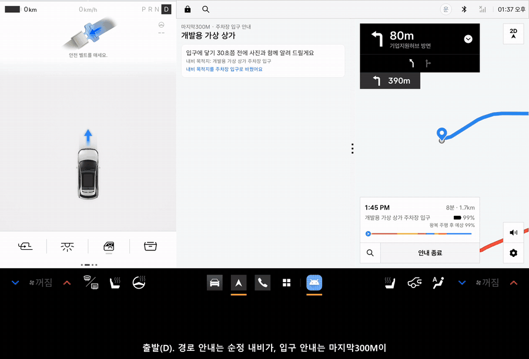](docs/demo/demo_1_navi_fix_and_entrance.mp4)

<sub>Pleos Connect 에뮬레이터 v2.1.0 화면 녹화를 3배 빠르게 줄인 미리 보기입니다. 누르면 한국어 자막이 든 시연 영상이 열립니다. 입구 그림은 실제 장소가 아닌 예시 그림입니다.</sub>

## 목차

- [왜 만들었나](#왜-만들었나)
- [하는 일](#하는-일)
- [화면](#화면)
- [기존 서비스와 무엇이 다른가](#기존-서비스와-무엇이-다른가)
- [심사용 빠른 실행](#심사용-빠른-실행)
- [테스트 환경](#테스트-환경)
- [사용한 SDK와 권한](#사용한-sdk와-권한)
- [구조](#구조)
- [검증](#검증)
- [알려진 한계](#알려진-한계)
- [개발자용: 직접 빌드하기](#개발자용-직접-빌드하기)
- [English summary](#english-summary)

## 왜 만들었나

상가가 밀집한 도심에서는 내비가 목적지 건물 앞까지 데려다줘도, 건물마다 붙어 있는 지하 주차장 경사로 중 어느 것이 목적지의 입구인지 알기 어렵습니다. 내비는 "목적지 부근입니다"에서 안내를 끝내고, 그 끝나는 곳이 주차장 입구가 아닐 때도 많습니다. 건물이 빽빽한 곳에서는 GPS 오차가 경사로 사이 간격과 비슷해서 좌표만으로는 풀리지 않습니다.

그래서 마지막300M은 좌표 대신 운전자가 눈으로 확인할 수 있는 단서로 안내합니다. 몇 번째 경사로인지, 어떤 간판 옆인지, 운전자 자리에서 본 입구가 어떻게 생겼는지를 알려 줍니다. 랜드마크로 안내하면 화면을 보는 시간과 길 찾기 실수가 함께 준다는 연구(May, Ross & Osman, 2005)를 따랐습니다.

## 하는 일

| 기능 | 설명 |
|---|---|
| **입구 미리 보기** | 속도에 맞춰 입구에 닿기 약 30초 전(150~500m)에 운전자 시점 사진, "오른쪽 · 두 번째 경사로", 경사로 약도를 보여 주고 음성으로 알립니다 |
| **입구 앞 경고** | 80m 앞에서 먼저 나오는 옆 건물 경사로와 지나치면 나오는 다음 건물 경사로를 짚어 줍니다 |
| **내비 목적지를 진짜 입구로** | 내비가 건물 앞으로 안내하면 순정 내비의 목적지를 입구 좌표로 바꿉니다. 정차 중에는 묻고, 그대로 출발하면 자동으로 바꾸고 음성으로 알립니다. 경로 안내는 순정 내비가 합니다 |
| **들어갈 수 있는 입구인지** | 유료 운영 / 무료 개방 / 문 닫음을 구분하고, 곧 닫으면 닫는 시각을, 내 차가 높이 제한에 걸리면 경고를 알립니다 |
| **주차 확인과 피드백** | 기어 P 로 주차를 알아채고, 옆 건물 의심 경고, "아니었어요"와 이유를 기록해 다음 안내에 반영합니다 |
| **다른 방향에서 올 때** | 진입 방향과 반대쪽이면 틀릴 수 있는 좌우·순서를 말하지 않고 간판으로 찾게 합니다 |
| **차 안에 맞춘 동작** | 주행 중에는 버튼·설정을 숨기고 큰 글씨와 음성만. 앱이 화면 뒤에 있어도 음성과 내비 위 알림으로 안내합니다. 밤 모드에서는 밤 사진을 씁니다 |

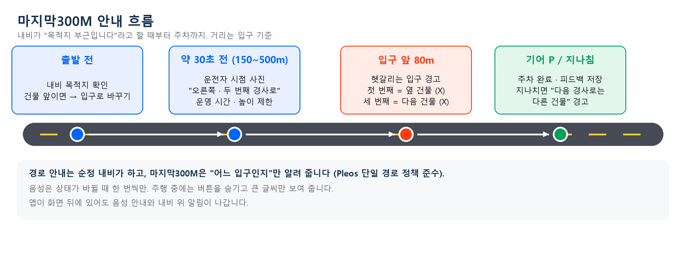

## 화면

| 미리 보기 (입구 약 30초 전) | 입구 앞 | 지나쳤을 때 | 주차 완료 |
|---|---|---|---|
| 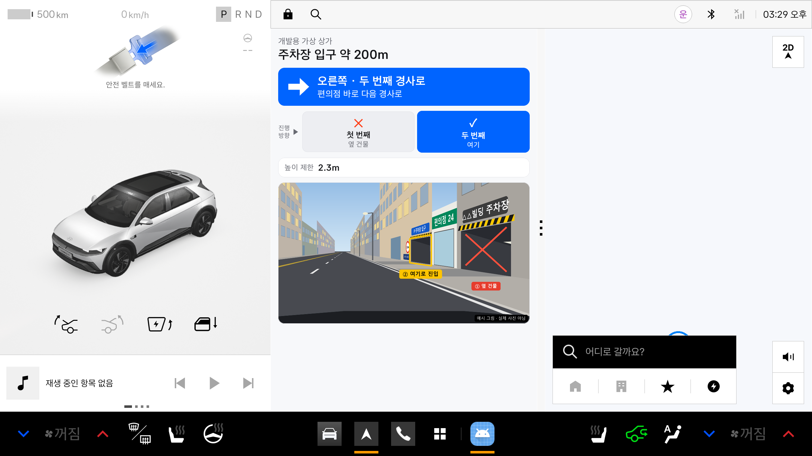 | 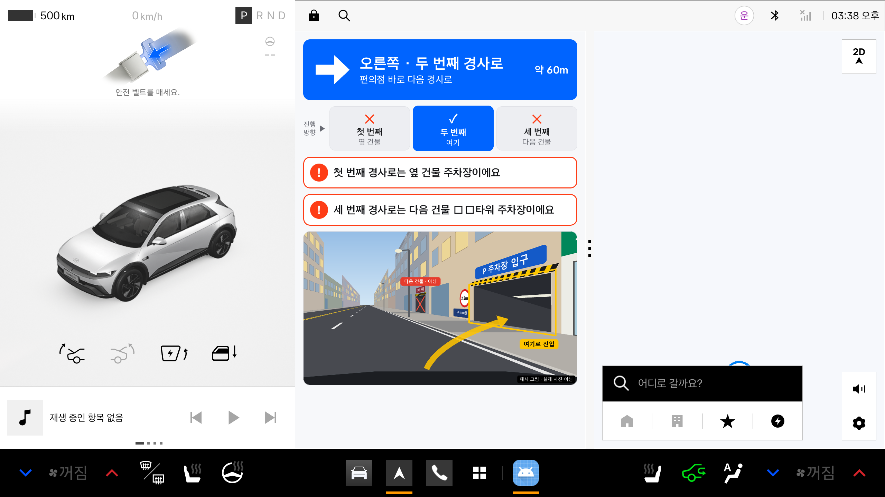 | 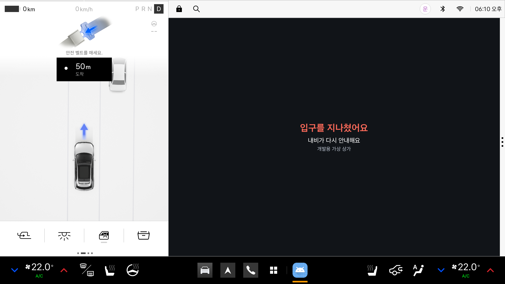 | 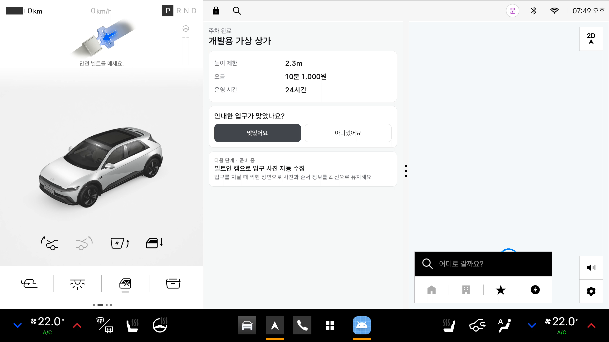 |

| 밤 모드 | 내 차 높이 경고 (다른 방향 입구) | 화면이 내려가 있을 때 도착 알림 |
|---|---|---|
| 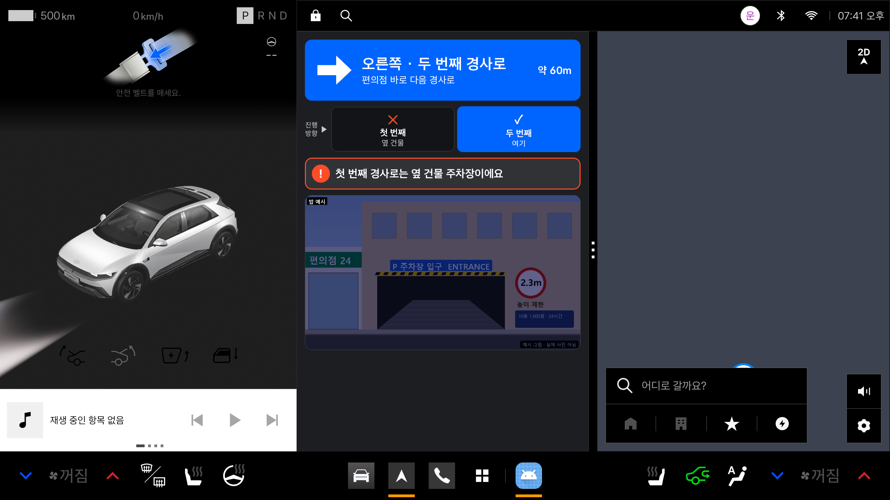 | 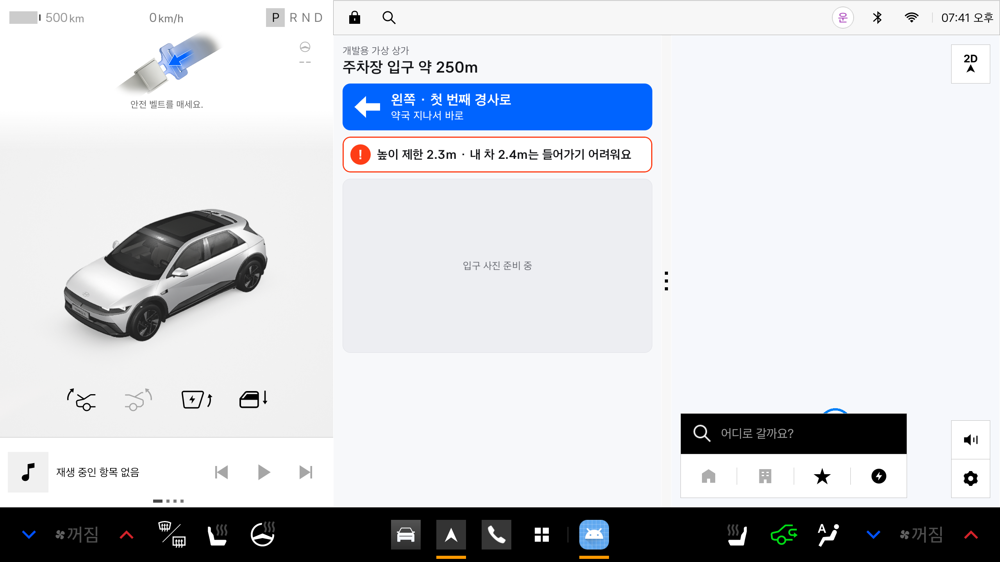 | 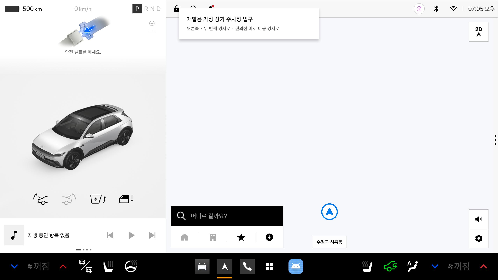 |

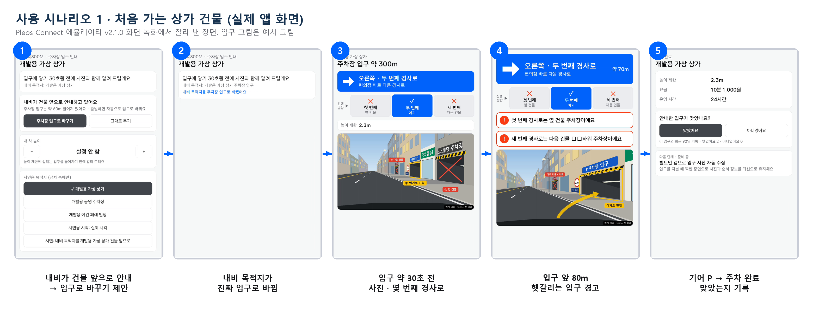

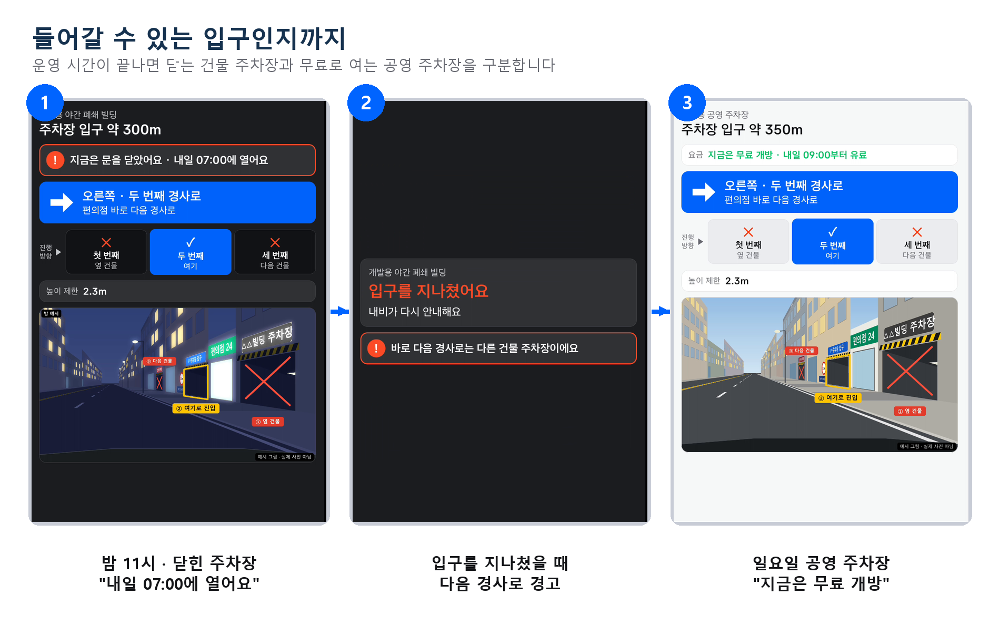

## 기존 서비스와 무엇이 다른가

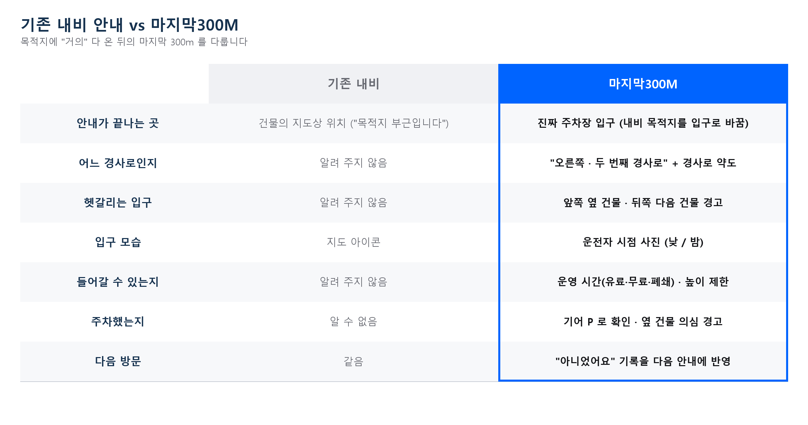

## 심사용 빠른 실행

Pleos Connect 에뮬레이터 v2.1.0 이 켜져 있다고 가정합니다. 에뮬레이터 사용자는 10번입니다.

```bash
# 1) Release 의 APK 설치와 권한
adb install 둠_마지막300M_release.apk
adb shell pm grant --user 10 com.lastmeter.parking pleos.car.permission.FUSED_LOCATION
adb shell pm grant --user 10 com.lastmeter.parking android.permission.POST_NOTIFICATIONS
adb forward tcp:8088 tcp:8088          # Virtual Console: http://127.0.0.1:8088/
```

2. 기어 P 에서 앱을 열고 "시연용 목적지"에서 **개발용 가상 상가**를 고릅니다(주행 중에는 숨겨집니다).
3. 창 막대(⋮)를 끌어 내비와 반반으로 나눕니다(선택).
4. Virtual Console 의 **Emulation Controls > Gear Selection > D**. 메인 화면의 큰 "Drive" 버튼은 위치를 따로 움직이므로 누르지 않습니다.
5. 주행 위치를 넣습니다: `tools/demo-drive.ps1` (Windows) 또는 `tools/demo-drive.sh arrive` (macOS·Linux). 지나치기는 `-Scenario pass` / `pass`.
6. 도착 후 Gear Selection 을 **P** 로 바꾸면 주차 완료 화면이 나옵니다.

운영 시간 시연은 "개발용 공영 주차장"이나 "개발용 야간 폐쇄 빌딩"을 고르고, 밤 모드는 `adb shell cmd uimode night yes` 로 켭니다. release APK 에는 개발용 버튼(SDK 점검판, 시연용 시각·내비 목적지 버튼)이 없으니, 이 시연은 debug 빌드로 합니다(아래 "직접 빌드하기"). 디버그판이 깔려 있으면 서명이 달라 release 설치가 실패하므로 `adb uninstall com.lastmeter.parking` 후 설치합니다.

## 테스트 환경

| 항목 | 값 |
|---|---|
| 에뮬레이터 | Pleos Connect Emulator v2.1.0 (Android 14, API 34), Automotive AVD (Cold boot, RAM 4GB) |
| 화면 규격 | 2560 × 1440 (가로형). 내비 옆 반쪽 칸(약 850 × 1210)이 기본, 앱 영역 전체로 띄우면 사진 왼쪽·안내 오른쪽 배치. 낮/밤 모드 지원 |
| 차량 상태 | Pleos Connect Virtual Console (기어), `adb emu geo fix` (위치) |
| 빌드 | Android Studio, Kotlin, Jetpack Compose, AGP 9.5, Gradle 9.8, compileSdk 37.2, targetSdk 34, minSdk 28 |
| APK | [Release](https://github.com/havl1412-maker/pleos-parking-entrance/releases/latest) 또는 [apk/둠_마지막300M_release.apk](apk/%EB%91%A0_%EB%A7%88%EC%A7%80%EB%A7%89300M_release.apk) (release 빌드, v3 서명) |

## 사용한 SDK와 권한

| SDK·API | 버전 | 쓰는 곳 | 권한 |
|---|---|---|---|
| NaviHelper | 3.0.5 | 내비 목적지 받기, 목적지를 입구로 바꾸기(`requestRoute`) | `NAVI_ROUTE`, `NAVI_ROUTE_SEARCH` |
| FusedLocation | 1.1.3 | 1초마다 위치 → 거리, 진행 방향, 속도(위치 변화로 계산) | `FUSED_LOCATION` |
| Vehicle | 2.3.2 | 기어 상태로 주차 판단 | `CAR_DRIVE` |
| TextToSpeech | 3.3.1 | 한국어 음성 안내 | `TTS_SERVICE` |
| AAOS CarUxRestrictions | - | 주행 중 화면 제한 | - |
| 포그라운드 서비스·알림 | - | 화면이 뒤에 있어도 위치 수신, 음성·알림 | `FOREGROUND_SERVICE`, `POST_NOTIFICATIONS` |

내비가 아닌 앱은 경로 안내를 하지 않는다는 단일 경로 정책을 지킵니다. "몇 m 앞 우회전" 같은 안내는 하지 않고, 쓰는 권한만 선언합니다. SDK 점검 결과와 함정은 [docs/sdk-check.md](docs/sdk-check.md)에 있습니다.

## 구조

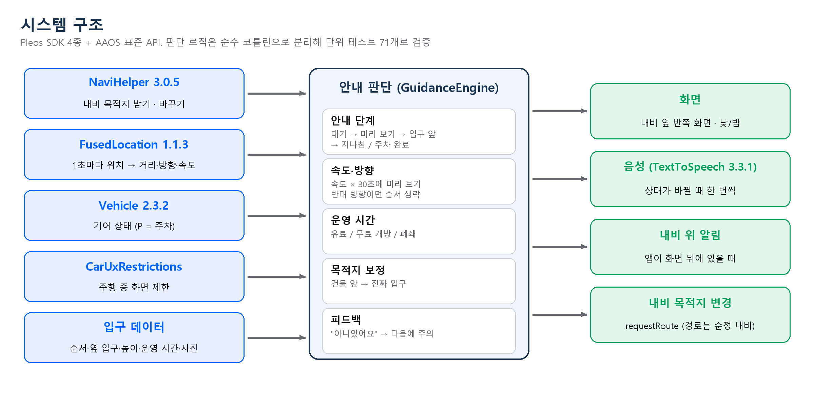

| 경로 (`app/src/main/java/com/lastmeter/parking/`) | 역할 |
|---|---|
| `guidance/GuidanceEngine.kt` | 안내 단계 판단(대기 → 미리 보기 → 입구 앞 → 지나침 / 주차 완료), 속도에 맞춘 시점, 방향 판단. 순수 코틀린 |
| `guidance/RouteAdjust.kt` | 내비 목적지를 입구로 바꿀지, 어느 입구로 바꿀지. 순수 코틀린 |
| `guidance/SpeechTexts.kt` | 음성·화면 문구 |
| `data/OpeningHours.kt` | 요일·시간·공휴일별 운영 상태(유료 / 무료 개방 / 폐쇄). 순수 코틀린 |
| `data/FeedbackLog.kt` | 주차 후 피드백 기록과 다음 안내 때 주의 표시. 순수 코틀린 |
| `data/EntranceRepository.kt`, `assets/entrances.json` | 입구 데이터 읽기와 오류 검사. 수집 방법: [docs/data-collection.md](docs/data-collection.md) |
| `ui/GuidanceController.kt` | Pleos SDK와 주행 제한 정보를 엔진에 연결. 앱 프로세스에 하나만 둔다 |
| `ui/GuidanceScreen.kt`, `ui/PleosTheme.kt` | 화면. Pleos 색상 토큰과 Asta Sans 글꼴 |
| `GuidanceKeepAliveService.kt`, `ArrivalNotifier.kt` | 화면이 뒤에 있을 때 위치 수신과 내비 위 알림 |
| `check/` | SDK 점검판 (debug 빌드에서만 보임) |

## 검증

- **단위 테스트 71개** (`./gradlew testDebugUnitTest`): 안내 단계 30, 입구 데이터 읽기 10, 운영 시간 9, 피드백 8, 음성 문구 8, 목적지 보정 6. [GitHub Actions](https://github.com/havl1412-maker/pleos-parking-entrance/actions/workflows/android.yml)가 push 마다 돌립니다.
- **에뮬레이터 기능 시험**: 권한 요청, 속도별 미리 보기, 입구 앞 경고, 지나침, 주차와 피드백, 주차 후 재출발, 신호 대기 P, 반대 방향, 운영 시간, 높이 경고, 밤 모드, 화면 뒤 동작, 내비 목적지 바꾸기, 데이터 오류 검사, release APK 를 모두 확인했습니다.

## 알려진 한계

| 한계 | 대응 |
|---|---|
| 지금 입구 데이터와 사진은 시연용 예시뿐 | 현장 조사 → 공공 데이터 → 사용자 피드백 → 빌트인 캠 자동 수집 순서로 확대 ([docs/roadmap.md](docs/roadmap.md)) |
| 실차가 아닌 에뮬레이터로만 검증 | 공모전 규정상 에뮬레이터 시연. 실차 시험 계획 |
| 만차·임시 폐쇄 같은 실시간 정보 없음 | 공영 주차장 실시간 정보 연동 계획 |
| 앱이 스스로 내비 옆 칸에 뜨지 못함 (플랫폼 제약) | 출발 전에 내비 옆에 띄워 두게 안내. 화면이 뒤에 있어도 음성과 내비 위 알림 |
| 공개 SDK 에 카메라 API 가 없음 | 빌트인 캠 사진 자동 수집은 다음 단계 계획으로 둠 |

## 개발자용: 직접 빌드하기

1. 개발 환경 세팅: [docs/setup.md](docs/setup.md) (Android Studio, Pleos 에뮬레이터 이미지, AVD)
2. 빌드와 테스트

   ```bash
   ./gradlew assembleDebug testDebugUnitTest
   adb install -r app/build/outputs/apk/debug/app-debug.apk
   ```

3. release 빌드는 저장소 밖의 서명 키(`keystore.properties`)가 있어야 서명됩니다.

이어서 작업하는 사람을 위한 메모: [docs/HANDOFF.md](docs/HANDOFF.md)

## English summary

**마지막300M (Last 300M)** is an in-car app for Hyundai's Pleos Connect (Android Automotive). When the navigation says "you are near your destination", it shows which of several adjacent parking ramps is the real entrance, using a driver's-eye photo, "right side, 2nd ramp", warnings about neighboring buildings' ramps, opening hours and height limits. It can also switch the stock navigation's destination to the real entrance coordinates, while routing stays with the stock navigation. Built with Kotlin and Jetpack Compose on Pleos SDKs (NaviHelper, FusedLocation, Vehicle, TextToSpeech); 71 unit tests; verified on the Pleos Connect emulator v2.1.0.
